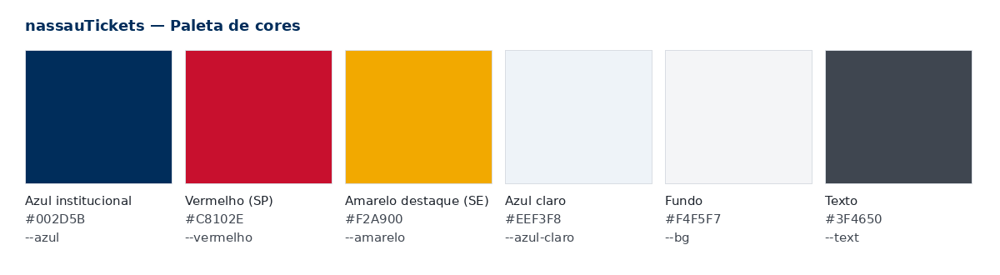

# Identidade Visual — nassauTickets

| Versão | Data | Responsável | Descrição |
|---|---|---|---|
| 1.0 | 25/11/2026 | Documentador 2 | Documentação da identidade visual aplicada ao frontend |

## 1. Conceito

A identidade do nassauTickets segue as cores institucionais da UNINASSAU (azul e amarelo) e acrescenta cores funcionais para diferenciar os tipos de senha. O visual é limpo, com bom contraste e fontes grandes, pensado para uso em totem, em painel de TV e em terminal de guichê.

## 2. Logotipo

O nome do sistema é escrito como **nassau****Tickets**: "nassau" em branco e "Tickets" em amarelo, sobre o cabeçalho azul institucional.

## 3. Paleta de cores

| Cor | Hex | Variável CSS | Uso |
|---|---|---|---|
| Azul institucional | `#002D5B` | `--azul` | Cabeçalho, títulos, botões primários, senha **SG** |
| Vermelho | `#C8102E` | `--vermelho` | Senha **SP**, ações de risco (descartar, não compareceu), erros |
| Amarelo | `#F2A900` | `--amarelo` | Destaques, número do guichê, foco do teclado, senha **SE** |
| Azul claro | `#EEF3F8` | `--azul-claro` | Fundos de destaque e cabeçalhos de tabela |
| Fundo | `#F4F5F7` | `--bg` | Fundo da aplicação |
| Texto | `#3F4650` | `--text` | Texto corrido |
| Título | `#1C222B` | `--text-h` | Texto de maior destaque |
| Borda | `#D9DDE3` | `--border` | Bordas e divisores |

As variáveis estão definidas em `frontend/src/index.css`.

### Cores por tipo de senha

| Tipo | Cor | Observação de acessibilidade |
|---|---|---|
| SP — Prioritária | Vermelho `#C8102E` | Sempre acompanhada do texto "SP" |
| SE — Retirada de Exames | Amarelo `#F2A900` (texto escuro) | Sempre acompanhada do texto "SE" |
| SG — Geral | Azul `#002D5B` | Sempre acompanhada do texto "SG" |

## 4. Tipografia

- **Fonte:** Arial / Helvetica (fontes do sistema, sem download, com carregamento rápido).
- **Senha no painel:** 48 px ou mais, em negrito.
- **Títulos:** 22 a 26 px, em negrito, na cor azul institucional.
- **Texto:** 14 a 16 px.
- **Números:** `font-variant-numeric: tabular-nums` no relógio, para que os dígitos não "pulem".

## 5. Componentes visuais

| Componente | Padrão |
|---|---|
| Cartões / páginas | Fundo branco, borda cinza `1px` e faixa superior azul de `4px` |
| Botão primário | Fundo azul, texto branco, cantos de `4px` |
| Botão secundário | Fundo branco, borda e texto azuis |
| Botão de perigo | Fundo vermelho, texto branco |
| Foco do teclado | Contorno amarelo de `3px` |
| Mensagens | Faixa lateral colorida (azul: informação, verde: sucesso, vermelho: erro) |

## 6. Acessibilidade visual

- Contraste mínimo WCAG AA nos textos principais (azul `#002D5B` sobre branco ≈ 14:1).
- O tipo de senha nunca é indicado só pela cor.
- O foco do teclado fica visível em todos os botões.
- O layout é responsivo para telas de totem, monitor e celular.
