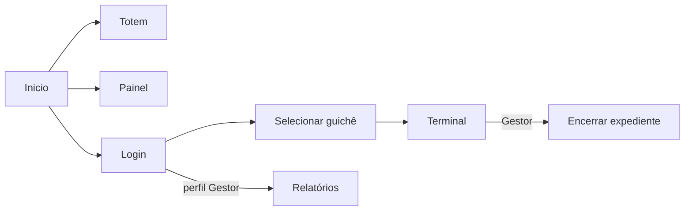
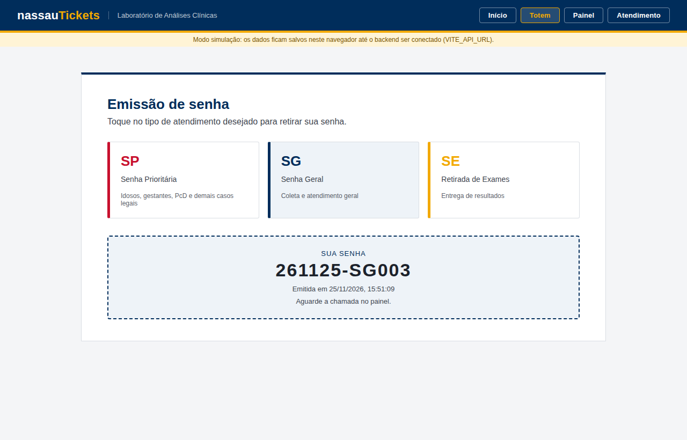
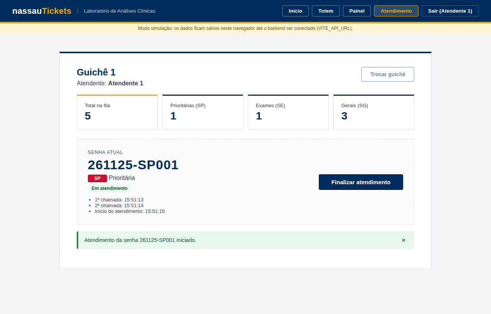
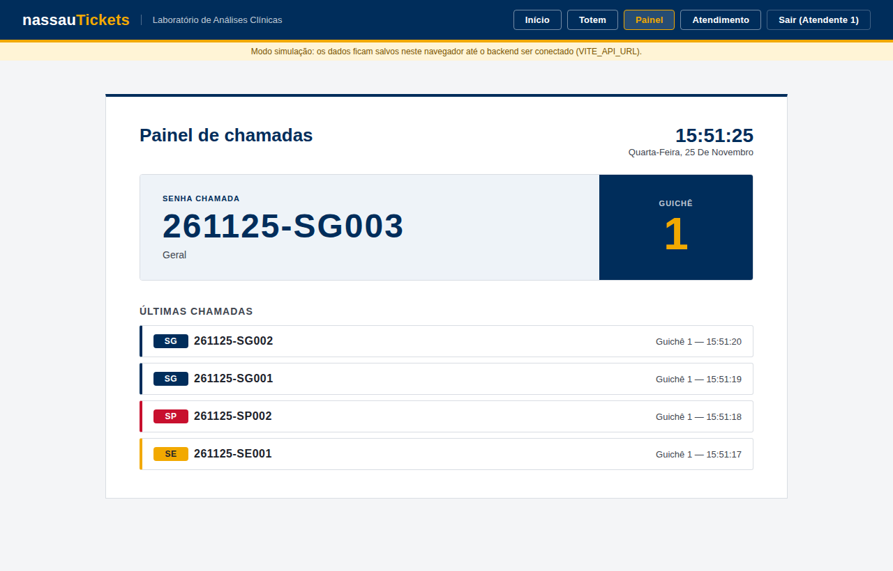
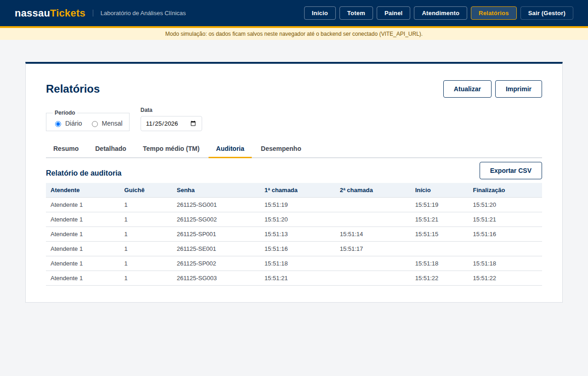

# Mockups das Interfaces — nassauTickets

As imagens abaixo são capturas das telas implementadas em React (`frontend/`), geradas a partir de um fluxo completo de teste: emissão de 6 senhas, atendimento no Guichê 1, um não comparecimento e consulta aos relatórios pelo gestor.

| # | Tela | Arquivo | Usuário |
|---|---|---|---|
| 1 | Início | [01-inicio.png](01-inicio.png) | Público |
| 2 | Totem — emissão de senha | [02-totem-emissao.png](02-totem-emissao.png) | Cliente (anônimo) |
| 3 | Login do atendente | [03-login.png](03-login.png) | Atendente |
| 4 | Seleção de guichê | [04-terminal-selecao-guiche.png](04-terminal-selecao-guiche.png) | Atendente |
| 5 | Terminal — senha chamada | [05-terminal-senha-chamada.png](05-terminal-senha-chamada.png) | Atendente |
| 6 | Terminal — em atendimento | [06-terminal-em-atendimento.png](06-terminal-em-atendimento.png) | Atendente |
| 7 | Painel de chamadas (5 últimas) | [07-painel-chamadas.png](07-painel-chamadas.png) | Público |
| 8 | Relatório — resumo | [08-relatorio-resumo.png](08-relatorio-resumo.png) | Gestor |
| 9 | Relatório — detalhado | [09-relatorio-detalhado.png](09-relatorio-detalhado.png) | Gestor |
| 10 | Relatório — tempo médio | [10-relatorio-tm.png](10-relatorio-tm.png) | Gestor |
| 11 | Relatório — auditoria | [11-relatorio-auditoria.png](11-relatorio-auditoria.png) | Gestor |
| 12 | Relatório — desempenho | [12-relatorio-desempenho.png](12-relatorio-desempenho.png) | Gestor |
| 13 | Painel sem conexão com o servidor | [13-painel-sem-conexao.png](13-painel-sem-conexao.png) | Público |

## Fluxo de navegação

## Pré-visualização

### Totem

### Terminal do atendente

### Painel de chamadas

### Relatório de auditoria

