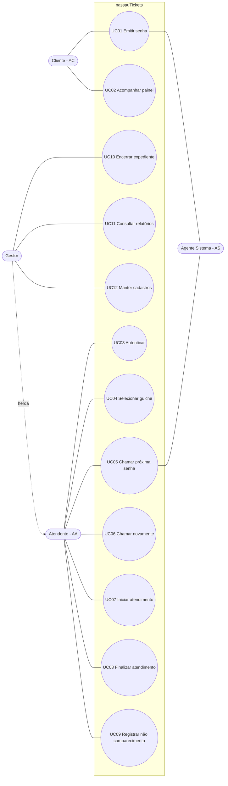

# Casos de Uso — nassauTickets

| Versão | Data | Responsável | Descrição |
|---|---|---|---|
| 1.0 | 25/11/2026 | Documentador 2 | Versão inicial dos casos de uso |

## 1. Diagrama de casos de uso

> O Gestor é um Atendente com perfil adicional, portanto também executa os casos UC03 a UC09.

## 2. Especificação dos casos de uso

### UC01 — Emitir senha
| Item | Descrição |
|---|---|
| Ator principal | Cliente (AC) |
| Pré-condição | Totem disponível. |
| Fluxo principal | 1. O cliente acessa o totem. 2. Escolhe o tipo SP, SG ou SE. 3. O sistema gera o número no formato YYMMDD-PPSQ (RN03). 4. O sistema coloca a senha na fila (`AGUARDANDO`). 5. O sistema exibe a senha e a data/hora de emissão. |
| Fluxo alternativo | 3a. Servidor indisponível: o totem exibe mensagem de erro e o cliente pode tentar novamente. |
| Pós-condição | Senha registrada na fila. |
| Regras | RN01, RN03, RN26 |

### UC02 — Acompanhar painel
| Item | Descrição |
|---|---|
| Ator principal | Cliente (AC) |
| Fluxo principal | 1. O painel exibe a senha chamada mais recentemente em destaque, com o guichê. 2. Exibe as demais entre as 5 últimas chamadas. 3. Atualiza automaticamente a cada nova chamada e anuncia por áudio. |
| Fluxo alternativo | 1a. Senha rechamada: o painel indica “Última chamada”. 1b. Servidor indisponível: o painel exibe aviso e mantém as últimas informações. |
| Regras | RN22, RN23 |

### UC03 — Autenticar
| Item | Descrição |
|---|---|
| Ator principal | Atendente (AA) / Gestor |
| Fluxo principal | 1. O atendente informa usuário e senha. 2. O sistema valida as credenciais. 3. O sistema libera as funções de acordo com o perfil. |
| Fluxo alternativo | 2a. Credenciais inválidas: o sistema exibe “Usuário ou senha inválidos”. |
| Regras | RN24, RN25 |

### UC04 — Selecionar guichê
| Item | Descrição |
|---|---|
| Ator principal | Atendente (AA) |
| Pré-condição | Atendente autenticado. |
| Fluxo principal | 1. O sistema lista os guichês. 2. O atendente seleciona o guichê em que está. 3. O terminal passa a exibir a fila e a senha atual daquele guichê. |
| Fluxo alternativo | — A troca de guichê é bloqueada enquanto houver senha em andamento. |

### UC05 — Chamar próxima senha
| Item | Descrição |
|---|---|
| Ator principal | Atendente (AA) |
| Pré-condição | Guichê livre, expediente aberto e fila não vazia. |
| Fluxo principal | 1. O atendente aciona “Chamar próxima senha”. 2. O sistema escolhe a senha conforme RN04–RN08. 3. A senha passa para `CHAMADA` e é vinculada ao guichê e ao atendente. 4. O painel é atualizado e o áudio é reproduzido. 5. A 1ª chamada é registrada para auditoria. |
| Fluxo alternativo | 1a. Fora do expediente: ação bloqueada. 1b. Fila vazia: ação indisponível. 2a. Chamada simultânea de outro guichê: o sistema garante que cada senha vá para um só guichê (RN27). |
| Regras | RN04–RN08, RN18, RN19, RN27 |

### UC06 — Chamar novamente
| Item | Descrição |
|---|---|
| Ator principal | Atendente (AA) |
| Pré-condição | Senha no estado `CHAMADA`. |
| Fluxo principal | 1. O atendente aciona “Chamar novamente”. 2. A senha passa para `CHAMADA_NOVAMENTE`. 3. O painel exibe “Última chamada” e repete o áudio. 4. A 2ª chamada é registrada para auditoria. |
| Regras | RN14 |

### UC07 — Iniciar atendimento
| Item | Descrição |
|---|---|
| Ator principal | Atendente (AA) |
| Pré-condição | Senha em `CHAMADA` ou `CHAMADA_NOVAMENTE` e cliente presente no guichê. |
| Fluxo principal | 1. O atendente aciona “Iniciar atendimento”. 2. A senha passa para `EM_ATENDIMENTO` e o horário de início é registrado. |
| Regras | RN17 |

### UC08 — Finalizar atendimento
| Item | Descrição |
|---|---|
| Ator principal | Atendente (AA) |
| Pré-condição | Senha em `EM_ATENDIMENTO`. |
| Fluxo principal | 1. O atendente aciona “Finalizar atendimento”. 2. A senha passa para `ATENDIDA` e o horário de finalização é registrado. 3. O guichê fica livre. |
| Regras | RN12, RN20 |

### UC09 — Registrar não comparecimento
| Item | Descrição |
|---|---|
| Ator principal | Atendente (AA) |
| Pré-condição | Senha em `CHAMADA_NOVAMENTE` (já chamada duas vezes). |
| Fluxo principal | 1. O atendente aciona “Não compareceu”. 2. A senha passa para `NAO_COMPARECEU`. 3. O guichê fica livre para chamar a próxima. |
| Regras | RN15, RN16 |

### UC10 — Encerrar expediente
| Item | Descrição |
|---|---|
| Ator principal | Gestor |
| Fluxo principal | 1. O gestor aciona “Encerrar expediente”. 2. O sistema pede confirmação. 3. As senhas `AGUARDANDO` passam para `DESCARTADA`. 4. O sistema informa a quantidade descartada. |
| Regras | RN19–RN21 |

### UC11 — Consultar relatórios
| Item | Descrição |
|---|---|
| Ator principal | Gestor |
| Fluxo principal | 1. O gestor escolhe o período (diário ou mensal) e a data. 2. O sistema exibe: resumo, quantitativo por prioridade, relatório detalhado, TM, auditoria e indicadores de desempenho. 3. O gestor pode exportar para CSV ou imprimir. |
| Fluxo alternativo | 1a. Usuário sem perfil Gestor: acesso negado. |
| Regras | RN25 |

### UC12 — Manter cadastros
| Item | Descrição |
|---|---|
| Ator principal | Gestor |
| Fluxo principal | 1. O gestor cadastra, altera ou desativa atendentes e guichês. |
| Situação | Pendente — depende da API do backend (ver `status-funcionalidades.md`). |
