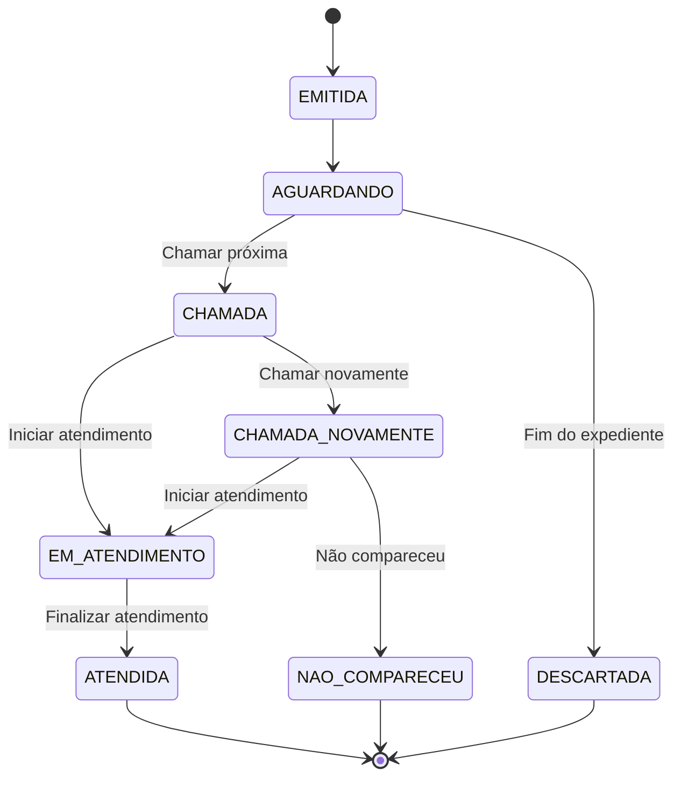

# Regras de Negócio — nassauTickets

| Versão | Data | Responsável | Descrição |
|---|---|---|---|
| 1.0 | 25/11/2026 | Documentador 2 | Organização inicial das regras de negócio |
| 1.1 | 26/11/2026 | Documentador 2 | Inclusão das regras RN28 (reinício diário da prioridade) e RN29 (bloqueio após encerramento manual) |

## 1. Tipos de senha

| ID | Regra |
|---|---|
| RN01 | Existem três tipos de senha: **SP** (Prioritária), **SG** (Geral) e **SE** (Retirada de Exames). |
| RN02 | Qualquer guichê pode atender qualquer tipo de senha (não existem guichês exclusivos). |

## 2. Numeração

| ID | Regra |
|---|---|
| RN03 | A senha segue o formato **YYMMDD-PPSQ**: `YY` ano (2 dígitos), `MM` mês (2 dígitos), `DD` dia (2 dígitos), `PP` tipo (SP, SG ou SE) e `SQ` sequência de 3 dígitos **por tipo**, reiniciada todos os dias. Exemplo: `261125-SP001`. |

## 3. Prioridade de chamada

| ID | Regra |
|---|---|
| RN04 | A **SP** possui a maior prioridade. |
| RN05 | A **SE** possui “prioridade operacional especial”: é chamada logo **após uma SP**, quando houver SE na fila. |
| RN06 | A **SG** possui a menor prioridade: é chamada quando não houver SE disponível no momento da vez de SE/SG. |
| RN07 | A cada novo atendimento deve ser chamada uma senha de prioridade diferente da anterior, alternando: **[SP] → [SE \| SG] → [SP] → [SE \| SG]**. |
| RN08 | Se uma fila estiver vazia, o sistema escolhe a próxima senha disponível mantendo a ordem de preferência das regras acima. Dentro do mesmo tipo, vale a ordem de emissão (FIFO). |

**Ordem de preferência aplicada pelo sistema:**

| Último tipo chamado | Ordem de busca da próxima senha |
|---|---|
| Nenhum (início do dia) ou SE / SG | SP → SE → SG |
| SP | SE → SG → SP |

**Exemplo:** fila emitida na ordem SG001, SG002, SP001, SE001, SP002, SG003 → chamada: **SP001, SE001, SP002, SG001, SG002, SG003**.

## 4. Tempo Médio de atendimento (TM)

| ID | Regra |
|---|---|
| RN09 | **SP**: TM de 15 minutos, variando aleatoriamente 5 minutos para mais ou para menos (10 a 20 min), em igual distribuição. |
| RN10 | **SG**: TM de 5 minutos, variando 3 minutos para mais ou para menos (2 a 8 min), em igual proporção. |
| RN11 | **SE**: 1 minuto em 95% dos atendimentos e 5 minutos em 5% dos atendimentos. |
| RN12 | O TM real é calculado pela diferença entre o início e a finalização de cada atendimento e apresentado no relatório de TM. |

## 5. Chamada, comparecimento e abandono

| ID | Regra |
|---|---|
| RN13 | Ao chamar uma senha, ela é exibida no painel com o guichê de destino. |
| RN14 | O atendente pode chamar a mesma senha **mais uma vez** (“Chamar novamente”), e o painel indica “Última chamada”. |
| RN15 | Após **duas chamadas** sem comparecimento, a senha é considerada **abandonada** (estado `NAO_COMPARECEU`) e o atendente passa para a próxima senha. |
| RN16 | Historicamente, cerca de **5%** das senhas emitidas não são atendidas por responsabilidade do cliente e devem ser descartadas sem execução do atendimento. |
| RN17 | O atendimento só é iniciado quando o cliente comparece ao guichê e o atendente aciona “Iniciar atendimento”. |
| RN18 | Um guichê só pode chamar uma nova senha após finalizar (ou registrar o não comparecimento de) a senha atual. |

## 6. Expediente

| ID | Regra |
|---|---|
| RN19 | O expediente para chamada de senhas começa às **7h** e termina às **17h**. |
| RN20 | Atendimentos em andamento no fim do expediente devem ser concluídos pelo atendente e encerrados pela funcionalidade “Finalizar atendimento”. |
| RN21 | Senhas que permanecerem na fila ao encerrar o expediente devem ser **descartadas** (estado `DESCARTADA`). |
| RN28 | A alternância de prioridade **reinicia todos os dias**: o primeiro atendimento do dia sempre procura uma SP, independentemente do último tipo chamado no dia anterior. Senhas de dias anteriores que tenham ficado na fila são descartadas na virada do dia. |
| RN29 | Após o **encerramento manual** do expediente pelo gestor, o sistema bloqueia novas chamadas e novas emissões até o dia seguinte, mesmo dentro do horário das 7h às 17h. Atendimentos já chamados ou em andamento podem ser concluídos. O gestor pode **reabrir** o expediente no mesmo dia, caso o encerramento tenha sido feito por engano. |

## 7. Painel

| ID | Regra |
|---|---|
| RN22 | O painel exibe **somente as 5 últimas senhas chamadas**. |
| RN23 | O painel **não pode exibir a próxima senha**, pois uma nova senha pode ser emitida entre o fim de um atendimento e a próxima chamada, alterando a sequência. |

## 8. Acesso e perfis

| ID | Regra |
|---|---|
| RN24 | Somente o atendente (AA) faz login no sistema. |
| RN25 | Um único atendente possui o perfil adicional de **Gestor**, responsável pelos cadastros e relatórios. |
| RN26 | O cliente (AC) interage de forma **anônima**, apenas pelo totem. |

## 9. Concorrência

| ID | Regra |
|---|---|
| RN27 | Se dois ou mais atendentes chamarem a próxima senha ao mesmo tempo, o sistema garante que cada senha vá para um único guichê: a primeira requisição processada recebe a senha de maior prioridade e a segunda recebe a seguinte, conforme as regras de prioridade. |

## 10. Máquina de estados da senha

| Estado | Significado |
|---|---|
| EMITIDA | Senha gerada no totem. |
| AGUARDANDO | Senha na fila, aguardando chamada. |
| CHAMADA | Senha chamada pela primeira vez para um guichê. |
| CHAMADA_NOVAMENTE | Segunda (e última) chamada. |
| EM_ATENDIMENTO | Cliente compareceu e o atendimento foi iniciado. |
| ATENDIDA | Atendimento finalizado. |
| NAO_COMPARECEU | Cliente não compareceu após duas chamadas. |
| DESCARTADA | Senha que permaneceu na fila no encerramento do expediente. |
